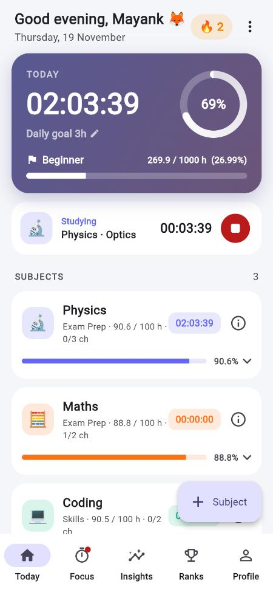
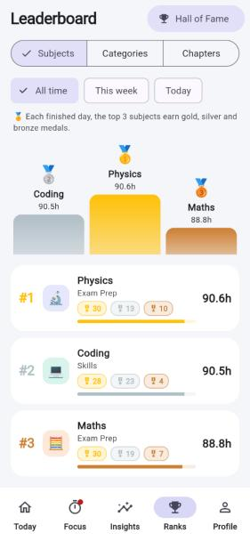
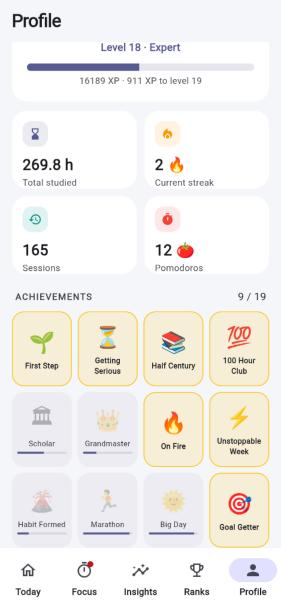

<p align="center"></p>

# 🚀 STP v2 — Study Tracker (Flutter)

Version 2 of **STP**, rebuilt from scratch in **Flutter / Material 3**.

| Today | Focus | Insights | Ranks | Profile |
|:---:|:---:|:---:|:---:|:---:|
|  |  |  |  |  |

*The icon: a stopwatch whose ring fills from white to gold as you study, wrapped around an open book with a golden "aha" spark.*
The original React Native app (v1) lives in the repository root on the `main` branch and is untouched.

📥 **Download the APK:** see the [v2.0.0 release](https://github.com/mayank20035/STP-Study-Tracker/releases/tag/v2.0.0).
- `STP-v2.0.0-arm64.apk` (~20 MB) — for almost every modern Android phone
- `STP-v2.0.0-universal.apk` (~55 MB) — works on any device

It installs **alongside** v1 (different package id: `com.mayank.stp_v2`). Android will ask you to allow installing from unknown sources.

## ✨ What's new in v2

| | Feature |
|---|---|
| 🎯 | **Focus mode** — full-screen timer with a progress ring. Stopwatch **or Pomodoro** (custom focus / break lengths, long breaks, auto-start). |
| 🔥 | **Streaks** — current & longest streak with a configurable daily minimum. |
| ⭕ | **Daily goal ring** on the Today dashboard. |
| 🟩 | **GitHub-style heatmap** (26 weeks) + month calendar; tap any day for a subject/chapter breakdown. |
| 📊 | **Insights** — week / month / year bar charts with average line, subject split donut, *when you study* hour chart. |
| 🧠 | **Smart insights** — peak hour, best weekday, week-over-week change, neglected subjects, average session length. |
| 🏅 | **19 achievements** (Night Owl, Marathon, 100 Hour Club, Pomodoro Pro …) with unlock celebration. |
| ⭐ | **XP & levels** — 1 XP per minute, titles from *Novice* to *Legend*. |
| 🏆 | **Leaderboard** — subjects / categories / chapters, *all-time / this week / today*, podium, Hall of Fame. |
| ✅ | **Syllabus tracking** — tick chapters as complete. |
| 🗒️ | **Session log** — every session is stored; edit, delete (with undo) or add a forgotten session manually. |
| 🎨 | Subject emoji + colour, 6 accent colours, light / dark / system theme, emoji avatars. |
| 🔁 | **Imports v1 backups** (`STP_Backup.json`) — your old data comes with you. |

## 🐛 v1 issues fixed

- History was deleted after 30 days → v2 keeps everything.
- Charts used UTC dates while timers used local dates → one consistent "study day" (default reset 5 AM, configurable).
- Sessions crossing the reset hour are now split correctly between days.
- Daily medals are now awarded on **that day's** time, not all-time totals.
- Running timer survives the app being closed (stored as a start timestamp).
- Reset / import now update the screen immediately; invalid backup files are rejected safely.

## 🛠️ Tech

Flutter 3.41 · Dart 3 · `provider` · `shared_preferences` · `fl_chart` · `share_plus` · `file_picker`

```
lib/
  models/      data classes (Subject, Chapter, StudySession, settings…)
  logic/       day boundaries, stats, streaks, insights, achievements
  services/    storage + backup (v2 & v1 formats)
  state/       StudyStore (ChangeNotifier) – timers, pomodoro, CRUD
  screens/     Today, Focus, Insights, Ranks, Profile, Subject detail, Session log
  widgets/     rings, heatmap, calendar, forms
```

See [IMPLEMENTATION_PLAN.md](IMPLEMENTATION_PLAN.md) for the full analysis of v1 and the design of v2.

## ▶️ Run / build

```bash
cd version2
flutter pub get
flutter test            # unit tests (day split, streaks, medals, v1 import)
flutter run             # on a device / emulator
flutter build apk --release
```
