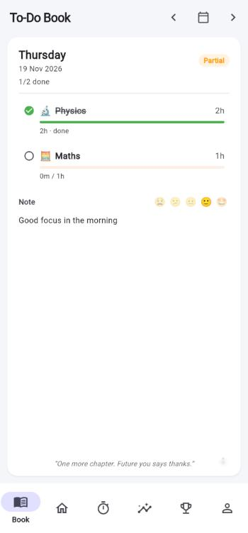
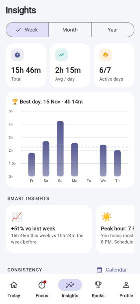

<p align="center"></p>

# 🚀 STP v2 — Study Tracker (Flutter)

Version 2 of **STP**, rebuilt from scratch in **Flutter / Material 3**.

## 📖 New in v2.3 — page curl, week view and catch-up

| Today's page | A past day | Target reached |
|:---:|:---:|:---:|
|  |  |  |

The app opens on a simple **To-Do Book**, one page per day. It reopens on the page you left it on.

1. **Plan:** tap *Add subject*, choose one of your subjects and set how long to study it (e.g. Physics 2h, Maths 1h 30m). Any page works: today, a future day, or a past day to log time you already studied.
2. **Study:** timers are free. Start any subject from **Today** or **Focus** whenever you like; the time counts on that day's page automatically, even if you add the subject to the page later.
3. **Pick (optional):** tap a task on any page: today, a **missed day** to catch up, or a **future day** to work ahead. A timer for that subject then counts toward that page and shows the time left.
4. **Alarm:** when a picked task's target is reached, the timer **stops by itself** at the exact second and an **alarm rings until you press STOP**. This also works when the app is closed or the phone is locked, because the alarm is scheduled as a notification with a custom chime, vibration and a lock-screen alert. There's also *Stop & keep going +15 min*.

The page:
- turns with a real **page curl**: the corner peels up showing the back of the paper; swipe left for the next day, right to go back (or use the arrows / date picker)
- **week view** (📖 icon in the corner): all 7 pages of a week on one screen, previous/next week, tap a page to open it
- **copy a week** to next week, in 2 weeks or any later week (same weekdays and study times; existing tasks are kept)
- a small Done / Partial / Missed label on past days
- a note and mood for each day
- the daily quote sits at the very bottom of the page

Details and the edge-case rules are in [TODO_BOOK_PLAN.md](TODO_BOOK_PLAN.md).

| Today | Focus | Insights | Ranks | Profile |
|:---:|:---:|:---:|:---:|:---:|
|  |  |  |  |  |

*The icon: a stopwatch whose ring fills from white to gold as you study, wrapped around an open book with a golden "aha" spark.*
The original React Native app (v1) lives in the repository root on the `main` branch and is untouched.

## 📥 Download the APK (v2.3.0)

| APK | Size | For |
|---|---|---|
| [**STP-v2.3.0-arm64.apk**](https://github.com/mayank20035/STP-Study-Tracker/releases/download/v2.3.0/STP-v2.3.0-arm64.apk) | 20.9 MB | Almost every modern Android phone (recommended) |
| [**STP-v2.3.0-universal.apk**](https://github.com/mayank20035/STP-Study-Tracker/releases/download/v2.3.0/STP-v2.3.0-universal.apk) | 57.3 MB | Any Android device |

Release notes: [v2.3.0 release page](https://github.com/mayank20035/STP-Study-Tracker/releases/tag/v2.3.0).

The first time you start a timer, allow notifications so the target alarm can ring.

It installs **alongside** v1 (different package id: `com.mayank.stp_v2`). Android will ask you to allow installing from unknown sources.

## ✨ Everything else in v2

| | Feature |
|---|---|
| 🎯 | **Focus mode** — full-screen timer with a progress ring. Stopwatch **or Pomodoro** (custom focus / break lengths, long breaks, auto-start). |
| 🔥 | **Streaks** — current & longest streak with a configurable daily minimum. |
| ⭕ | **Daily goal ring** on the Today dashboard. |
| 🟩 | **GitHub-style heatmap** (26 weeks) + month calendar; tap any day for a subject/chapter breakdown. |
| 📊 | **Insights** — week / month / year bar charts with average line, subject split donut, *when you study* hour chart. |
| 🧠 | **Smart insights** — peak hour, best weekday, week-over-week change, neglected subjects, average session length. |
| 🏅 | **19 achievements** (Night Owl, Marathon, 100 Hour Club, Pomodoro Pro …) with unlock celebration. |
| ⭐ | **XP & levels** — 1 XP per minute, titles from *Novice* to *Legend*. |
| 🏆 | **Leaderboard** — subjects / categories / chapters, *all-time / this week / today*, podium, Hall of Fame. |
| ✅ | **Syllabus tracking** — tick chapters as complete. |
| 🗒️ | **Session log** — every session is stored; edit, delete (with undo) or add a forgotten session manually. |
| 🎨 | Subject emoji + colour, 6 accent colours, light / dark / system theme, emoji avatars. |
| 🔁 | **Imports v1 backups** (`STP_Backup.json`) — your old data comes with you. |

## 🐛 v1 issues fixed

- History was deleted after 30 days → v2 keeps everything.
- Charts used UTC dates while timers used local dates → one consistent "study day" (default reset 5 AM, configurable).
- Sessions crossing the reset hour are now split correctly between days.
- Daily medals are now awarded on **that day's** time, not all-time totals.
- Running timer survives the app being closed (stored as a start timestamp).
- Reset / import now update the screen immediately; invalid backup files are rejected safely.

## 🛠️ Tech

Flutter 3.41 · Dart 3 · `provider` · `shared_preferences` · `fl_chart` · `share_plus` · `file_picker` · `flutter_local_notifications`

```
lib/
  models/      data classes (Subject, Chapter, StudySession, settings…)
  logic/       day boundaries, stats, streaks, insights, achievements
  services/    storage, backup (v2 & v1 formats), alarm notifications
  state/       StudyStore (ChangeNotifier) – book, timer gate, auto-stop, pomodoro, CRUD
  screens/     Book, Today, Focus, Insights, Ranks, Profile, Alarm, Subject detail, Session log
  widgets/     rings, heatmap, calendar, forms
```

See [IMPLEMENTATION_PLAN.md](IMPLEMENTATION_PLAN.md) for the full analysis of v1 and the design of v2.

## ▶️ Run / build

```bash
cd version2
flutter pub get
flutter test            # 60 tests: day split, streaks, medals, v1 import, To-Do book & alarm edge cases
flutter run             # on a device / emulator
flutter build apk --release
```

`flutter run` installs a **separate debug app**, "STP v2 (debug)" (`com.mayank.stp_v2.debug`), next to the real "STP v2" (`com.mayank.stp_v2`). Debug runs never replace or wipe the real app's data. Release builds keep the normal package id, so they still update an existing install with its data intact.
